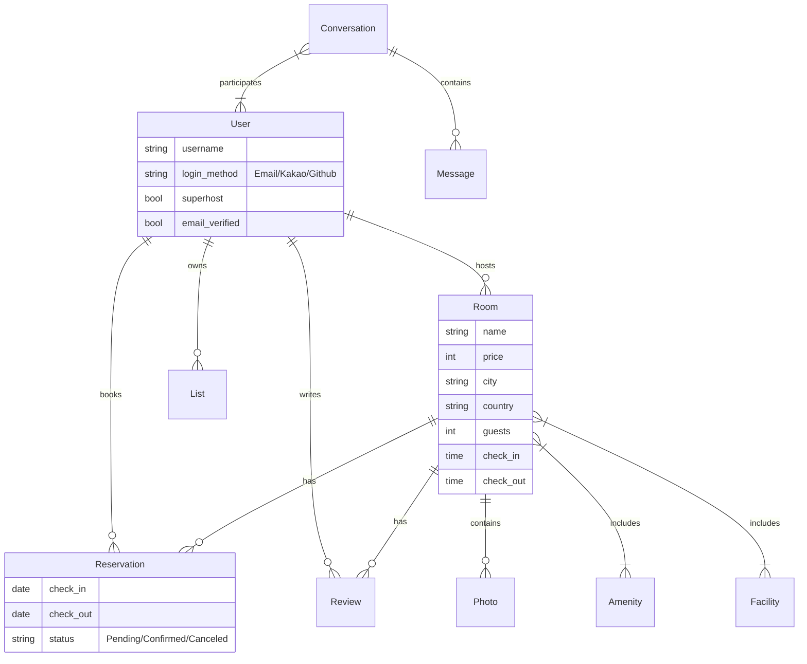

# 🏠 K-Sookbak (K-숙박) | 한국형 숙박 공유 플랫폼

   

> **"한국인의 정서와 사용자 경험에 최적화된 숙박 예약 서비스"**
>
> **K-Sookbak**은 글로벌 서비스 Airbnb의 핵심 비즈니스 로직을 벤치마킹하여, 한국 사용자에게 익숙한 UI/UX와 소셜 로그인(Kakao) 등의 편의 기능을 더해 독자적으로 재설계한 풀스택 웹 애플리케이션입니다.

---

## 📚 목차 (Table of Contents)

1. [🛠 기술 스택 및 선정 이유 (Tech Stack)](#-기술-스택-및-선정-이유-tech-stack)
2. [🗂 데이터베이스 아키텍처 (ERD & Schema)](#-데이터베이스-아키텍처-erd--schema)
3. [💡 핵심 기능 (Key Features)](#-핵심-기능-key-features)
4. [🚀 기술적 도전과 문제 해결 (Trouble Shooting)](#-기술적-도전과-문제-해결-trouble-shooting)
5. [📝 개발 회고 및 성장 (Retrospective)](#-개발-회고-및-성장-retrospective)
6. [💻 설치 및 실행 (Installation)](#-설치-및-실행-installation)

---

## 🛠 기술 스택 및 선정 이유 (Tech Stack)

본 프로젝트는 **안정적인 데이터 처리**와 **빠른 MVP(Minimum Viable Product) 개발**을 목표로 기술 스택을 선정했습니다.

### 1. Backend: Python & Django
* **Django Framework**: "Batteries Included" 철학을 가진 Django를 선택했습니다. 숙박 예약 서비스 특성상 **회원 관리(Auth), 관리자 패널(Admin), 보안(CSRF/XSS 방어)** 등이 필수적인데, Django는 이를 내장하고 있어 비즈니스 로직 구현에만 집중할 수 있었습니다.
* **Django ORM**: 복잡한 예약 쿼리와 관계형 데이터(User-Room-Reservation)를 직관적인 Python 코드로 제어하기 위해 SQL 대신 ORM을 적극 활용했습니다.

### 2. Frontend: Django Template & Tailwind CSS
* **Tailwind CSS**: 기존의 Bootstrap과 달리 정해진 스타일을 덮어쓰는 방식이 아니라, 유틸리티 클래스를 조합하여 **K-Sookbak만의 독창적인 디자인 시스템**을 구축했습니다. 별도의 CSS 파일을 오가는 컨텍스트 스위칭 비용을 줄여 개발 생산성을 높였습니다.
* **Gulp**: SCSS 컴파일과 이미지 최적화 등 프론트엔드 빌드 작업을 자동화하기 위해 사용했습니다.

### 3. Database: SQLite (Dev) → PostgreSQL (Prod)
* **RDBMS**: 예약 데이터의 정합성(ACID)이 서비스의 핵심이므로, 트랜잭션 관리에 강점이 있는 관계형 데이터베이스를 선택했습니다.

---

## 🗂 데이터베이스 아키텍처 (ERD & Schema)

숙박 예약 시스템의 데이터 무결성을 보장하기 위해 고도화된 관계형 모델을 설계했습니다.



### 주요 모델 설계 의도

1.  **Users (확장형 유저 모델)**
    * Django의 기본 `AbstractUser`를 상속받아 `bio`, `avatar`, `currency`(선호 통화), `language`(선호 언어) 필드를 추가했습니다.
    * `login_method`: 소셜 로그인(Kakao, Github)과 이메일 로그인을 구분하여 인증 로직을 분기 처리했습니다.
    * `email_verified`: 이메일 인증 여부를 저장하여 보안 등급을 관리합니다.

2.  **Rooms & Photos (1:N 정규화)**
    * 하나의 숙소에 수십 장의 사진이 등록될 수 있습니다. `Room` 테이블에 이미지 필드를 두는 대신, `Photo` 모델을 별도로 분리하고 `ForeignKey`로 연결하여 데이터 확장에 유연하게 대처했습니다.
    * `Amenities`(편의시설)와 `Facilities`(시설)는 `ManyToManyField`로 설계하여 다중 선택이 가능하도록 했습니다.

3.  **Reservations (예약 상태 관리)**
    * 예약의 생명주기를 관리하기 위해 `status` 필드를 두어 `Pending`(대기) → `Confirmed`(확정) → `Canceled`(취소) 상태를 체계적으로 관리합니다.
    * `in_progress()`, `is_finished()` 메서드를 모델 내부에 구현하여 비즈니스 로직의 재사용성을 높였습니다.

---

## 🚀 기술적 도전과 문제 해결 (Trouble Shooting)

### 1. 동적 검색 필터링 구현과 ORM 최적화
**문제 상황 (Context):**
사용자가 도시, 가격 범위, 침대 수, 편의시설(Wifi, 주차장) 등 10가지가 넘는 조건을 선택적으로 검색할 때, 모든 경우의 수에 대해 `if-else` 문을 작성하는 것은 코드를 비대하게 만들고 유지보수를 어렵게 했습니다.

**해결 과정 (Solution):**
* **Dictionary Unpacking 활용**: `filter_args`라는 딕셔너리에 유효한 검색 조건만 동적으로 추가한 뒤, `Room.objects.filter(**filter_args)` 문법을 사용하여 한 줄의 쿼리로 처리했습니다.
* **M2M 필드 필터링 이슈 해결**: 편의시설(`Amenities`)은 여러 개를 동시에 만족해야 합니다. 단순 `filter`는 `OR` 연산으로 동작할 위험이 있어, 검색된 쿼리셋(QuerySet)에 대해 반복적으로 `filter`를 체이닝(Chaining)하여 **교집합(Intersection)**을 구하는 방식으로 "모든 조건을 만족하는 숙소"를 정확히 추출했습니다.

```python
# rooms/views.py 로직 예시
for amenity in amenities:
    qs = qs.filter(amenities=amenity) # 교집합 필터링 (Chaining)
```

### 2. 소셜 로그인(OAuth) 중복 가입 방지 및 예외 처리
**문제 상황 (Context):**
이미 이메일로 가입한 사용자가 같은 이메일을 사용하는 Kakao 계정으로 로그인을 시도할 때, 계정이 이중으로 생성되거나 DB 충돌이 발생할 수 있었습니다.

**해결 과정 (Solution):**
* **Custom Exception 도입**: `GithubException`, `KakaoException`을 정의하여 로그인 실패 원인을 명확히 했습니다.
* **방어적 로직 구현**: 소셜 로그인 시도 시, 해당 이메일이 이미 존재하는지 먼저 확인(`User.objects.get(email=email)`)합니다.
    * 만약 존재한다면, 해당 계정의 `login_method`를 확인합니다.
    * 로그인 방법이 다를 경우(예: 이메일 가입자가 카카오 로그인 시도), 즉시 에러를 발생시키고 "해당 이메일은 이미 가입되어 있습니다. 이메일로 로그인해주세요"라는 메시지와 함께 로그인 페이지로 리다이렉트 처리하여 데이터 무결성을 지켰습니다.

### 3. Django Template의 한계와 커스텀 템플릿 태그
**문제 상황 (Context):**
템플릿(HTML) 내에서 복잡한 연산(예: URL 파라미터 조합, 페이지네이션 계산)을 처리하려다 보니 뷰 로직이 템플릿에 섞이는 문제가 발생했습니다.

**해결 과정 (Solution):**
* **Mixin과 Partials 활용**: 반복되는 UI 요소(방 카드, 로그인 폼 등)를 `mixins/room_card.html`과 같은 별도 파일로 분리하고 ``로 재사용하여 코드 중복을 60% 이상 줄였습니다.
* **URL Reverse**: 하드코딩된 URL 대신 ``와 같이 네임스페이스를 활용하여, URL 구조 변경 시 유지보수가 용이하도록 설계했습니다.

---

## 📝 개발 회고 및 성장 (Retrospective)

### 📈 무엇을 배웠는가?
1.  **프레임워크의 철학 이해**: Django가 제공하는 강력한 기능들(`Form`, `ModelForm`, `Generic Views`)을 사용하며, 바퀴를 다시 발명하는 대신 프레임워크의 컨벤션을 따르는 것이 개발 속도와 코드 퀄리티에 얼마나 큰 영향을 주는지 체감했습니다.
2.  **데이터 중심의 사고**: 화면을 먼저 그리기보다, `User`와 `Room`, `Reservation` 간의 관계(Relationship)를 먼저 정의하고 DB 스키마를 설계하는 것이 전체 프로젝트의 뼈대가 됨을 배웠습니다.
3.  **협업을 위한 코드 관리**: `flake8`과 같은 린터를 적용하고, 일관된 커밋 메시지 컨벤션을 유지하며 협업 가능한 코드 베이스를 만드는 연습을 했습니다.

### 🔧 아쉬운 점과 향후 개선 계획
* **동시성 문제(Race Condition)**: 현재 로직에서는 마지막 남은 방 하나를 두 명이 동시에 결제할 경우 중복 예약이 발생할 수 있습니다. 향후 **DB 트랜잭션 락(Select for Update)**이나 **Redis**를 도입하여 이를 해결할 계획입니다.
* **CI/CD 파이프라인**: 현재는 수동 배포 방식이지만, **Docker**와 **AWS(EC2, RDS, S3)**, **Github Actions**를 연동하여 코드 푸시 시 자동 배포되는 파이프라인을 구축할 예정입니다.

---

## 💻 설치 및 실행 (Installation)

```bash
# 1. 저장소 복제
git clone https://github.com/your-username/K-Sookbak.git

# 2. 필수 패키지 설치
pip install -r requirements.txt

# 3. 데이터베이스 마이그레이션
python manage.py migrate

# 4. 관리자 계정 생성
python manage.py createsuperuser

# 5. 더미 데이터 생성 (테스트용)
python manage.py seed_users --number 50
python manage.py seed_rooms --number 100

# 6. 서버 실행
python manage.py runserver
```
